# 🏢 Enterprise CRM System for Lead Management & Sales Performance Monitoring

[](https://dotnet.microsoft.com/)
[](https://learn.microsoft.com/en-us/dotnet/csharp/)
[](https://dotnet.microsoft.com/apps/aspnet/mvc)
[](https://www.mysql.com/)
[](https://learn.microsoft.com/en-us/ef/core/)
[](https://ai.google.dev/)
[](https://www.questpdf.com/)
[](LICENSE)

> **A Web-Based Customer Relationship Management (CRM) System for Lead Management and Sales Performance Monitoring**  
> *Developed for **Flora Real Capita Group** to centralize multi-tier lead management, automate SLA compliance, and provide real-time sales performance intelligence.*

---

## 📌 Executive Summary

Modern enterprise sales operations face critical bottlenecks when relying on manual spreadsheets, fragmented call records, and unstructured communication channels. These practices lead to untracked lead leakages, slow customer response times, unverified field interactions, and non-transparent performance evaluations.

This **Enterprise CRM System** is an end-to-end, multi-tier web platform engineered with **ASP.NET Core 9 MVC** and **MySQL**. It unifies external lead capture, algorithmic distribution, automated background SLA compliance enforcement, AI-assisted customer feedback analysis, target allocation, and executive reporting into a single auditable ecosystem.

---

## 🚀 Key Features & Highlights

### 🛡️ 1. Six-Tier Role-Based Access Control (RBAC)
Granular permissions, secure cookie authentication, and tailored dashboards for every corporate level:
* **Administrator**: System governance, role permissions, master settings, SLA policies, and complete audit logs.
* **Sales Manager**: Departmental oversight, hierarchical quota assignment, lead pipeline tracking, and officer performance analytics.
* **Team Lead**: Sub-team management, officer lead reassignment, team activity auditing, and conversion velocity tracking.
* **Sales Officer**: Personalized lead queues, follow-up scheduling, multimedia proof uploads, and individual quota progress.
* **Account Department**: Payment verification, invoice validation, and financial record auditing.
* **HR Department**: Sales personnel roster management, attendance, and departmental organizational chart maintenance.

---

### ⚡ 2. Automated Multi-Source Lead Ingestion & Distribution
* **Google Forms API Integration**: Background polling service (`GoogleLeadPollingService`) leverages OAuth 2.0 to ingest prospective inquiries into the CRM automatically.
* **Deduplication Safeguards**: Intelligent phone and email verification prevents redundant lead creation.
* **Algorithmic Distribution**: Supports round-robin and rules-based auto-assignment to active, eligible sales officers without manual management intervention.

---

### ⏱️ 3. Enforceable SLA Engine (`IHostedService`)
* **Real-time Background Worker (`SLABackgroundService`)**: Continuously monitors lead stages and timestamps.
* **Strict Timers**:
  * **1-Hour Acceptance SLA**: Ensures assigned officers claim incoming leads promptly.
  * **3-Hour First Feedback SLA**: Mandates rapid initial outreach to prospects.
  * **Next Follow-up Deadlines**: Triggers automatic escalation alerts and visual flags for overdue customer touches.

---

### 🤖 4. AI-Powered Follow-up Intelligence (Google Gemini)
* Integrated with **Google Gemini AI** (`IGeminiFollowUpAnalysisService`) to evaluate sales officers' client interaction logs.
* Automatically analyzes customer sentiment, buying intent, deal probability, and recommends optimal next-step actions.

---

### 📸 5. Auditable Feedback & Multimedia Proof Uploads
* Eliminates fabricated client meetings by requiring verifiable evidence uploads (audio recordings, meeting photos, or client documentation).
* Maintains an immutable, timestamped audit trail of all status transitions, reassignments, and remarks.

---

### 🎯 6. Target Allocation & Performance Analytics
* **Hierarchical Targets**: Assign and track Weekly and Monthly sales revenue and unit targets.
* **Sales Velocity Tracking**: Live metrics comparing targets vs. actual closures per team and officer.

---

### 📑 7. Dynamic Multi-Format Export Services
* **PDF Reports**: High-performance, pixel-perfect document generation using **QuestPDF**.
* **Excel Spreadsheets**: Detailed data export and pipeline analysis using **ClosedXML**.

---

## 🏛️ System Architecture

The application adopts a clean, decoupled **Multi-Tier Layered Architecture** ensuring maintainability, testability, and separation of concerns:

```
┌────────────────────────────────────────────────────────┐
│               Presentation Layer (MVC)                │
│    Razor Views (Bootstrap 5, Responsive UI, Charts)    │
└───────────────────────────┬────────────────────────────┘
                            │
┌───────────────────────────▼────────────────────────────┐
│                    Controller Layer                    │
│     (Auth, Admin, SalesManager, TeamLead, SalesOfficer)│
└───────────────────────────┬────────────────────────────┘
                            │
┌───────────────────────────▼────────────────────────────┐
│                     Service Layer                      │
│ (LeadService, SLAService, GeminiService, ReportService)│
│    Background Hosted Services: SLABackgroundService    │
└───────────────────────────┬────────────────────────────┘
                            │
┌───────────────────────────▼────────────────────────────┐
│              Data Access Layer (EF Core 9)             │
│   ApplicationDbContext, Entity Configurations, Seeders │
└───────────────────────────┬────────────────────────────┘
                            │
┌───────────────────────────▼────────────────────────────┐
│               Persistence Layer (MySQL)                │
│        Relational Schema, Foreign Keys, Audit Tables   │
└────────────────────────────────────────────────────────┘
```

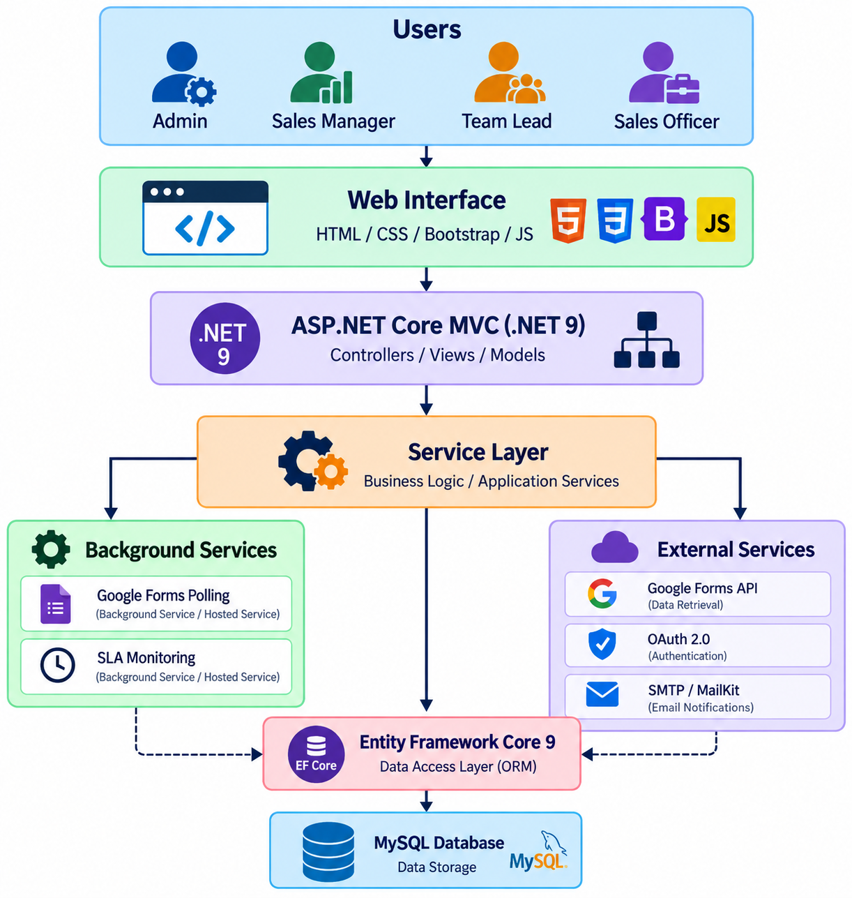

---

## 🗄️ Database Design (ERD)

The database schema is normalized and structured to support high transaction volumes, auditability, and relational integrity across users, roles, leads, assignments, feedback, SLA logs, and targets:

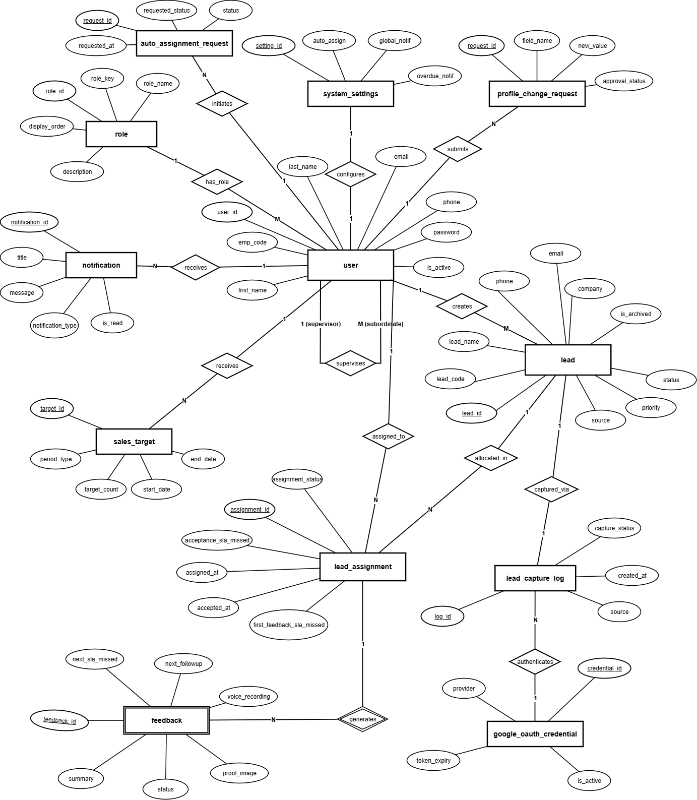

---

## 📸 System Screenshots & Live Demonstration

| 🔐 Authentication Portal | 🛠️ Administrator Dashboard |
| :---: | :---: |
| 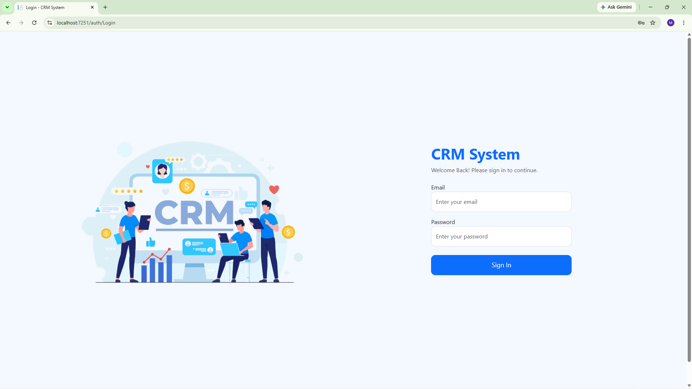 | 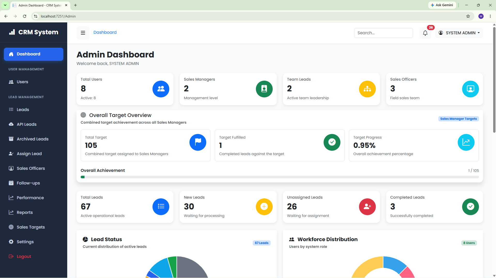 |

| 📈 Sales Manager Dashboard | 👥 Team Lead Workspace |
| :---: | :---: |
| 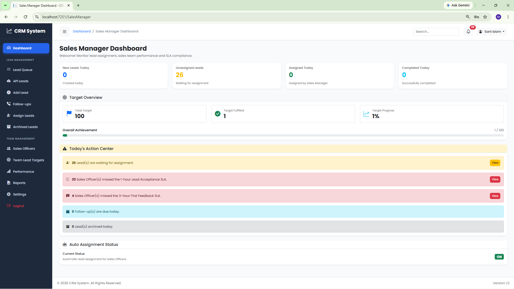 | 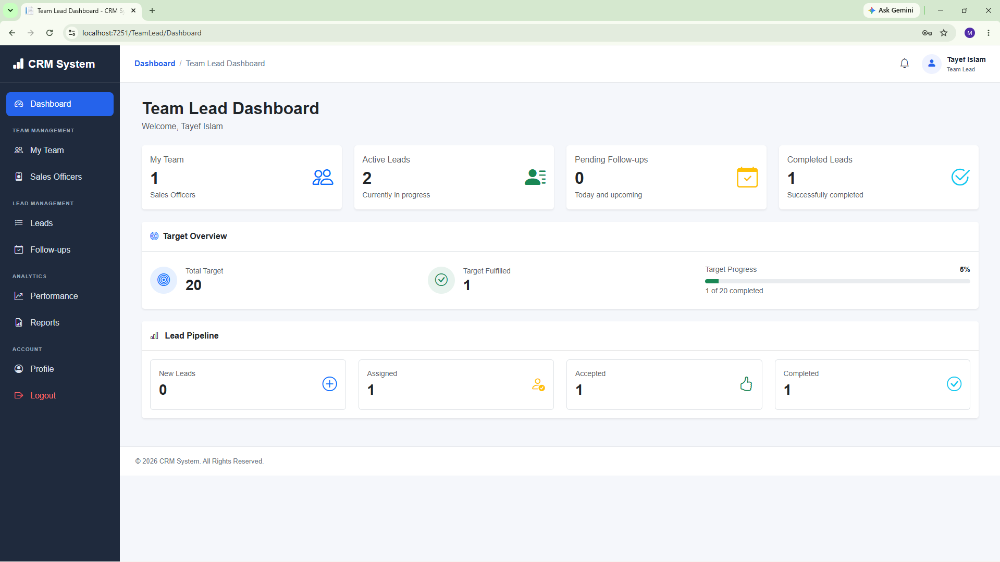 |

| 🎯 Sales Officer Dashboard | 📋 Central Lead Management |
| :---: | :---: |
| 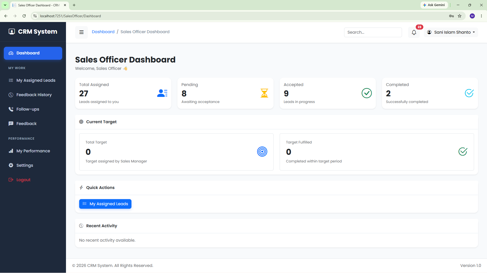 | 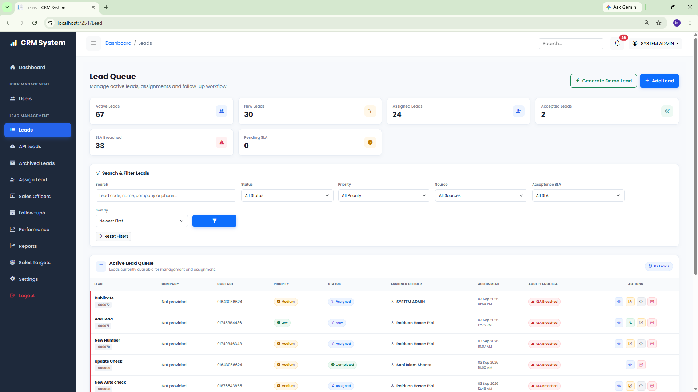 |

| 🔄 Lead Assignment & Allocation | 📝 Feedback Submission & Proof Upload |
| :---: | :---: |
| 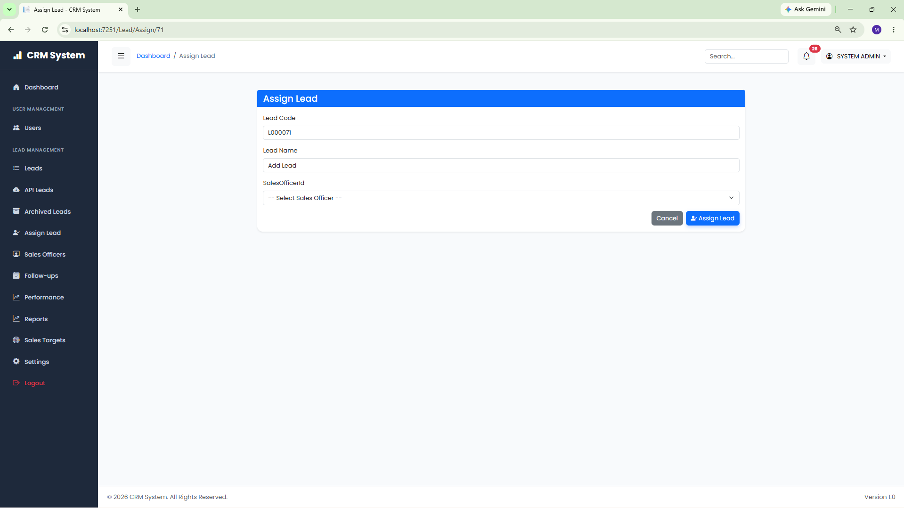 | 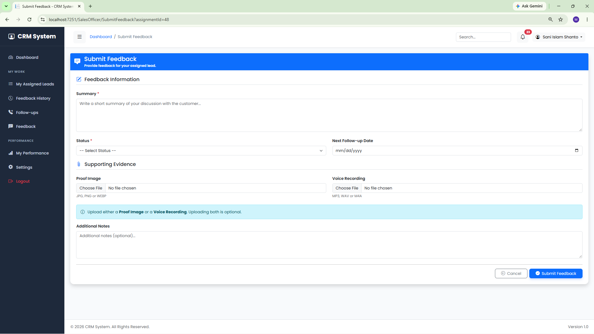 |

| 📜 Feedback History & Audit Trail | 🎯 Target & Quota Management |
| :---: | :---: |
| 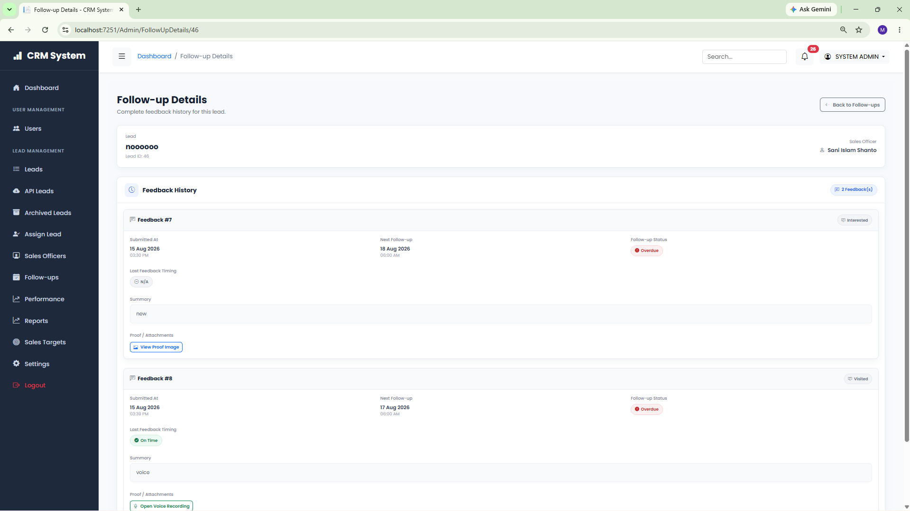 | 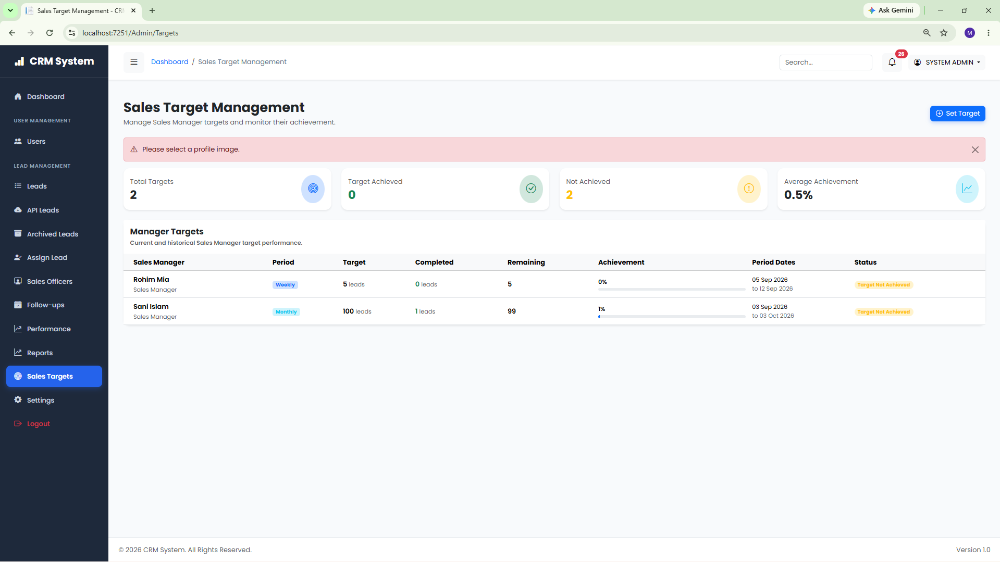 |

| 📊 Reports & Data Export | ⚙️ System Settings & Policies |
| :---: | :---: |
| 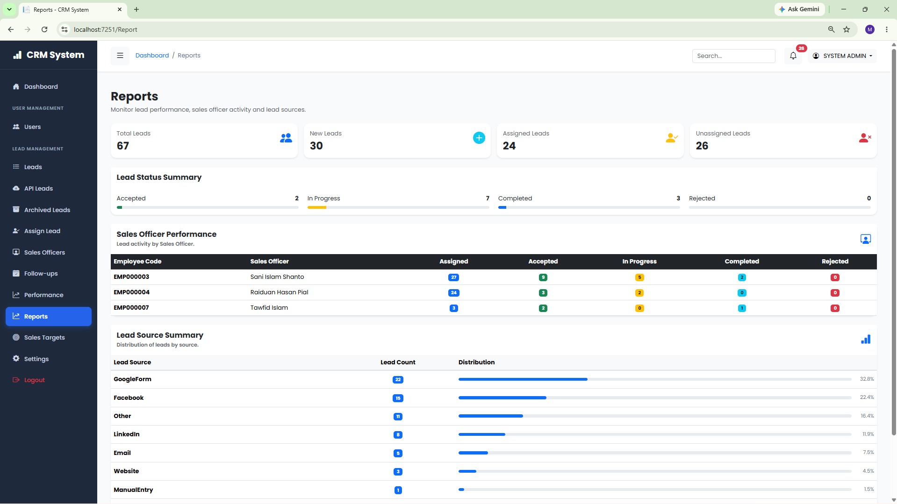 | 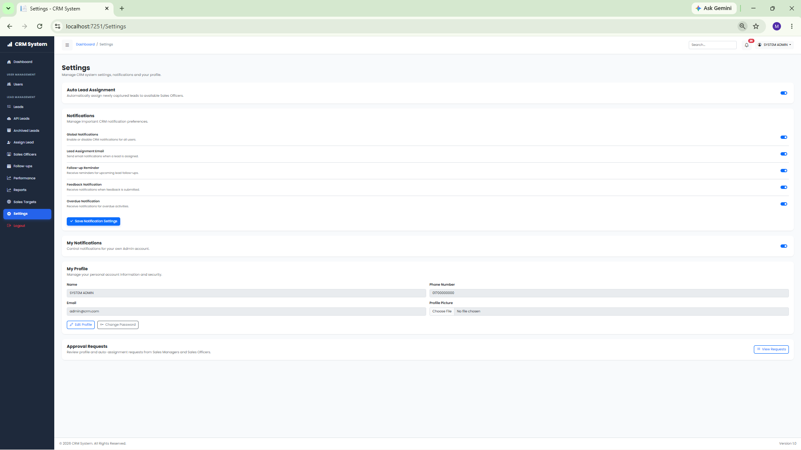 |

---

## 🛠️ Technology Stack

| Category | Technology | Purpose |
| :--- | :--- | :--- |
| **Backend Framework** | ASP.NET Core 9.0 (MVC) | High-performance enterprise web framework |
| **Programming Language**| C# 13 | Strongly-typed, object-oriented core logic |
| **Database** | MySQL (8.0+) | Relational database storage |
| **ORM** | Entity Framework Core 9 (Pomelo MySQL) | Code-First migrations and data persistence |
| **Authentication** | Cookie Authentication with Claims & RBAC | Role-based identity and session management |
| **Password Security** | BCrypt.Net-Next | Salted cryptographic password hashing |
| **Background Processing**| `Microsoft.Extensions.Hosting.IHostedService` | Background SLA worker & Google Lead poller |
| **Artificial Intelligence**| Google Gemini API (`HttpClient`) | AI sentiment & follow-up suggestion engine |
| **Document Export** | QuestPDF & ClosedXML | Enterprise PDF and Excel report generation |
| **Email Communication** | MailKit & MimeKit | Asynchronous SMTP notifications |
| **External Integration**| Google APIs (Forms v1 & OAuth 2.0) | Automated external inquiry ingestion |
| **Frontend UI** | HTML5, CSS3, JavaScript, Bootstrap 5 | Responsive, intuitive enterprise dashboard UI |

---

## ⚙️ Getting Started & Setup Guide

### 1. Prerequisites
Ensure the following tools are installed on your workstation:
* [.NET 9.0 SDK](https://dotnet.microsoft.com/download/dotnet/9.0)
* [MySQL Server](https://dev.mysql.com/downloads/mysql/) or [XAMPP / MariaDB](https://www.apachefriends.org/)
* [Git](https://git-scm.com/)

---

### 2. Clone the Repository
```bash
git clone https://github.com/mdsaniislamshanto/CRMSystem.git
cd CRMSystem
```

---

### 3. Configure `appsettings.json`
Update your database connection string and API keys in `appsettings.json`:

```json
{
  "ConnectionStrings": {
    "DefaultConnection": "server=localhost;port=3306;database=crmsystem_db;user=root;password=;"
  },
  "EmailSettings": {
    "SenderName": "CRM System",
    "SenderEmail": "your-email@example.com",
    "Password": "your-gmail-app-password",
    "Host": "smtp.gmail.com",
    "Port": 587
  },
  "GoogleForms": {
    "ClientId": "YOUR_GOOGLE_CLIENT_ID.apps.googleusercontent.com",
    "ClientSecret": "YOUR_GOOGLE_CLIENT_SECRET",
    "RedirectUri": "https://localhost:7251/GoogleForms/Callback",
    "FormId": "YOUR_GOOGLE_FORM_ID"
  },
  "GeminiSettings": {
    "ApiKey": "YOUR_GEMINI_API_KEY",
    "Model": "gemini-1.5-flash"
  }
}
```

---

### 4. Database Migration & Automated Seeding
The application automatically applies EF Core migrations and seeds initial roles, settings, and the default administrator user on startup:

```bash
dotnet restore
dotnet build
dotnet run
```

Navigate to: `https://localhost:7251` or `http://localhost:5251`.

---

### 🔑 5. Default Credentials

The database seeder automatically initializes the master system administrator:

| Field | Default Value |
| :--- | :--- |
| **Email** | `admin@crm.com` |
| **Password** | `Admin@123` |
| **Role** | System Administrator |

*(Note: Additional roles for Sales Managers, Team Leads, and Sales Officers can be provisioned through the Administrator Dashboard).*

---

## 👨‍💻 Author & Contact

**Md. Sani Islam Shanto**  
*Software Engineer | ASP.NET Core & Full-Stack Web Development*

* 🏢 **Client / Industry Partner:** Flora Real Capita Group
* 🌐 **GitHub:** [@mdsaniislamshanto](https://github.com/mdsaniislamshanto)
* 📧 **Email:** [mdsaniislamshanto@gmail.com](mailto:mdsaniislamshanto@gmail.com)
* 💼 **LinkedIn:** [Md. Sani Islam Shanto](https://www.linkedin.com/in/mdsaniislamshanto)

---

## 📄 License

This project is open-source and licensed under the [MIT License](LICENSE) - see the [LICENSE](LICENSE) file for details.
